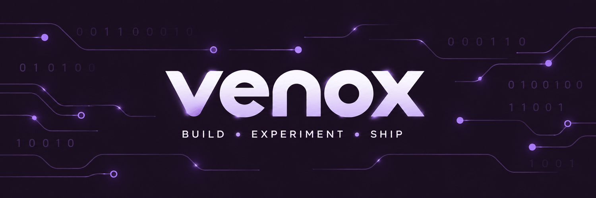

# Hi, I'm Yug 👋
### AI experiments. Local tools. Useful interfaces.

I build across the stack: model internals in PyTorch, Python APIs, and React interfaces. 
My repositories explore small language models, speech processing, document extraction, and local AI assistants.

[Explore projects](#-selected-projects) · [Browse repositories](https://github.com/venox-2007?tab=repositories) · [GitHub activity](https://github.com/venox-2007?tab=overview)

---

## 🔬 What I build

- **Models from first principles** — tokenization, causal attention, training loops, and text generation.
- **Experiments with evidence** — comparing extraction tools and measuring audio quality alongside recognition errors.
- **AI tools with interfaces** — local model integration, permission-aware workflows, and web or desktop frontends.

## 🧰 Technologies used in my projects

These badges reflect repository code and tooling, rather than a claim of expertise in every technology.

**Languages & web fundamentals**

**Models, retrieval & data**

**Applications & testing**

## ✨ Selected projects

### 🧠 [GroundUpGPT](https://github.com/venox-2007/GroundUpGPT)
**A small GPT-style language model, built from the fundamentals.**

Custom byte-level BPE, causal self-attention, decoder blocks, pretraining and conversational fine-tuning code, plus a FastAPI streaming backend and Next.js chat interface. The repository documents experiments with approximately 5M and 27M parameter models.

`Python` `PyTorch` `FastAPI` `Next.js`  
**Scope:** Educational model engineering; trained checkpoints are local artifacts and are not bundled in the repository.

### 🌾 [FarmWise](https://github.com/venox-2007/FarmWise)
**A multilingual agriculture assistant with crop-image analysis and live voice/video interaction.**

Combines Gemini-powered crop analysis, structured treatment suggestions, a live assistant that accepts camera frames and microphone audio, and Open-Meteo weather forecasts. A React/TypeScript interface brings together crop advice, market views, and agricultural schemes.

`TypeScript` `React` `Gemini API` `Vite`  
**Scope:** API-integrated application prototype; market prices come from local data, and farmer login is a local profile flow.

### 🎙️ [Speech Enhancement & ASR Correction](https://github.com/venox-2007/speech-enhancement-asr-correction)
**A trained U-Net, pretrained Whisper, and pronunciation-aware transcript correction.**

Includes a Streamlit demo, a committed enhancement checkpoint, and saved evaluations on 824 test recordings. The key finding: denoising improves objective audio metrics but increases Whisper word errors; conservative correction yields a small improvement within each audio path.

`Python` `PyTorch` `Whisper` `GPT-2` `Streamlit`  
**Scope:** Completed experiment with documented limitations; the full pipeline does not beat Whisper on the original noisy audio.

### 📄 [PDF Extraction Benchmark](https://github.com/venox-2007/pdf-extraction-benchmark)
**Comparing document extraction approaches through a shared evaluation toolkit.**

Adapters for PyMuPDF, OpenDataLoader, PaddleOCR, Tesseract, and Docling, with native/scanned document classification, benchmark pipelines, reports, and a Streamlit comparison interface.

`Python` `OCR` `PyMuPDF` `Streamlit`  
**Scope:** Implemented benchmarking toolkit; results depend on document type, dataset, and runtime environment.

### 🖥️ [Personal AI OS](https://github.com/venox-2007/personal-ai-os)
**A local AI assistant project with a desktop interface.**

Combines an Ollama tool-calling provider, FastAPI backend, memory and workflow modules, permission and approval handling, and a React/Electron frontend. Includes backend tests and desktop packaging scripts.

`Python` `Ollama` `FastAPI` `React` `Electron`  
**Scope:** Development project; integrations and packaging need to be evaluated in their intended local environment.

### 📋 [Akshar Connect](https://github.com/venox-2007/akshar-connect-attendance-app)
**Attendance and student-record workflows for an educational NGO use case.**

Teacher/admin views, attendance history, CSV exports, and English/Hindi/Marathi interfaces. The code includes Supabase authentication/data paths, a PostgreSQL migration with access policies, and a local demo fallback.

`TypeScript` `React` `Tailwind CSS` `Supabase`  
**Scope:** Demo plus backend integration code; live deployment and server-side policy enforcement are not established by the repository alone.

<b>🌱 More builds & earlier experiments</b>

 

| Project | What it explores |
| :--- | :--- |
| [ResearchOS](https://github.com/venox-2007/research-os) | Research-workflow prototype with FAISS/BM25 retrieval, LangGraph orchestration, and traceable evidence; the current LLM factory uses mock providers. |
| [AtomQuest Goal Portal](https://github.com/venox-2007/atomquest-goal-portal) | React hackathon dashboard for goal approvals, weight validation, quarterly check-ins, and reports using mock data. |
| [TaskMaster](https://github.com/venox-2007/TaskMaster-Vibe2Ship) | React/Express productivity-coach prototype with Gemini-backed planning and a focus timer. |
| [Global Population Predictor](https://github.com/venox-2007/global-population-predictor) | Streamlit exploration of country population trends using quadratic regression; forecasts are illustrative extrapolations. |
| [Merit & Mint](https://github.com/venox-2007/Merit-Mint) | Static skincare storefront demo with product filters and quick views; contact submission is frontend-only. |

---

## 📊 GitHub Stats

  

  

  

  Cards refresh periodically. Language percentages reflect repository code, not proficiency.

---

**From model internals to the interface around them.**

[Code & repositories](https://github.com/venox-2007?tab=repositories) · [Contributions & activity](https://github.com/venox-2007?tab=overview)

